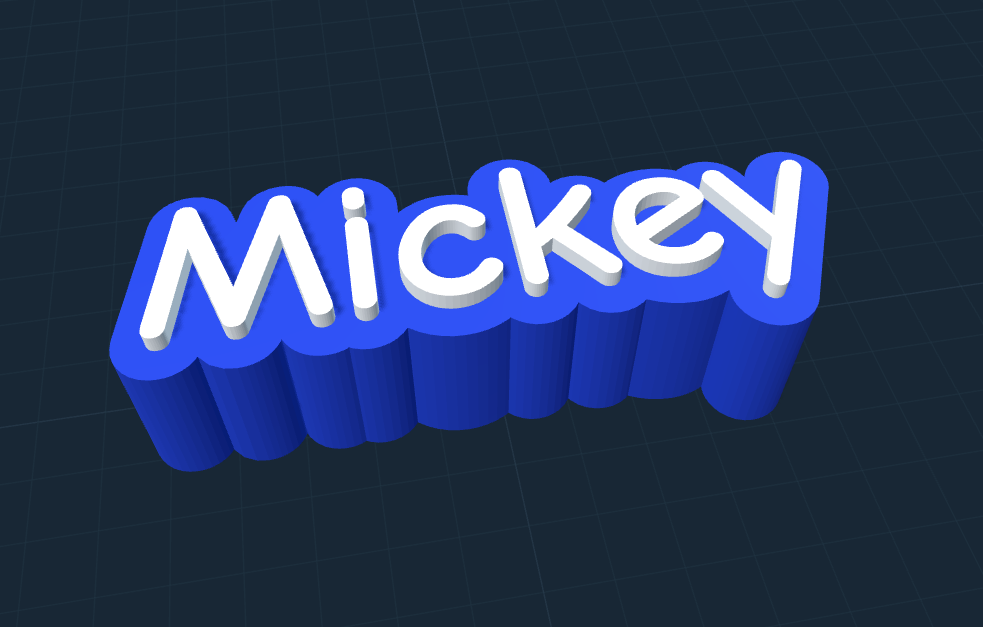
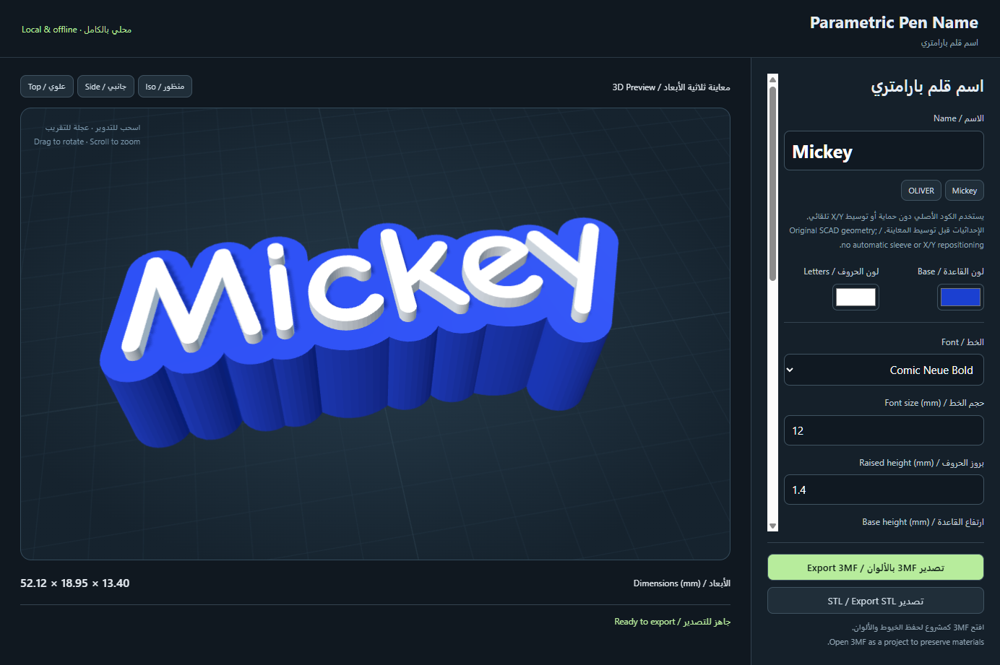

# اسم قلم بارامتري

[English](README.md) · [تحميل نسخة Windows](https://github.com/music-dj/parametric-pen-name/releases/latest)

توليد نموذج اسم القلم بالكود الأصلي OpenSCAD: حروف بارزة افتراضياً 1.4 مم فوق قاعدة بارتفاع 12 مم، وحدود offset(delta = 2.3) الأصلية. الكود الأصلي نفسه ينفذ التوليد. يمكن تعديل الخط والحجم والهامش وارتفاع القاعدة والبروز وقطر النفق وطوله واتجاهه وإحداثياته وتوسيط Z التلقائي ومحاذاة RTL واللونين. FRONTBACK محور X وTOPBOTTOM محور Y كما في الكود المرفق.





## تشغيل البرنامج

1. نزّل ملف Windows ZIP من [الإصدارات](https://github.com/music-dj/parametric-pen-name/releases/latest).
2. فك ضغط الملف بالكامل إلى مجلد عادي.
3. شغّل `ParametricPenName.exe` واترك بقية الملفات بجانبه.
4. اكتب الاسم وعدّل الإعدادات ودوّر المعاينة، ثم صدّر STL أو 3MF بالألوان.

البرنامج يعمل محلياً دون حساب أو إنترنت. النسخة محمولة وليست مثبتاً، وهي غير موقعة رقمياً.

## التصدير والأبعاد

الأبعاد بالملمتر. STL يحفظ الشكل فقط. 3MF يحفظ الأجزاء بألوانها، مع إعدادات خيوط Bambu Studio وOrcaSlicer. افتحه كمشروع وراجع توزيع الألوان. لا يرفق البرنامج بروفايل طابعة أو معايرة خيوط. تفسير الألوان يعتمد أيضاً على برنامج التقطيع. توجد نماذج مصدّرة في [examples](examples).

## الإعدادات

يتوفر حقل الاسم ومحددا اللون دائماً.

| الحقل | الوصف | الافتراضي |
| --- | --- | --- |
| `font` | الخط / Font | `comic` |
| `penLetterHeight` | حجم الخط / Font size (mm) | `12` |
| `letterThickness` | بروز الحروف / Raised height (mm) | `1.4` |
| `baseHeight` | ارتفاع القاعدة / Base height (mm) | `12` |
| `outlineMargin` | توسعة الإطار / Outline offset (mm) | `2.3` |
| `rtl` | محاذاة يمين / Right alignment | `false` |
| `holeOrientation` | محور النفق / Tunnel axis | `FRONTBACK` |
| `holeDiameter` | قطر النفق / Tunnel diameter (mm) | `7.8` |
| `holeLength` | طول النفق / Tunnel length (mm) | `150` |
| `holeX` | موضع X / X position (mm) | `21` |
| `holeY` | موضع Y / Y position (mm) | `4` |
| `autoHoleZ` | Z تلقائي / Automatic Z | `true` |
| `holeZ` | موضع Z / Z position (mm) | `6` |

## الحدود والفحص

حافظنا على الحدود الأصلية: تغيير الاسم أو تكبير النفق قد يكشفه عند المناطق الضيقة. عدّل الهامش أو موضع النفق أو قطره؛ لا تضاف دعامة مستطيلة مخفية. التوسيط التلقائي يخص Z افتراضياً، بينما X وY إعدادات صريحة.

نجحت اختبارات الشبكات المغلقة والحجم الموجب والإدخال غير الصحيح والتصدير بصيغتي STL و3MF. اختُبرت الواجهة وتعديل القيم واستعادة الافتراضي، وكذلك نسخة EXE المجمعة. راجع [تقرير الهندسة](docs/geometry-test.json) و[تقرير الواجهة](docs/ui-test.json). لم تُنفذ طباعة فعلية؛ اطبع عينة قصيرة قبل الإنتاج.

## تشغيل السورس وبناء EXE

تحتاج Node.js 22 أو أحدث وnpm. نفّذ داخل مجلد المشروع:

```powershell
npm ci
npm start
npm test
npm run test:ui
npm run build:windows
```

للسورس: ثبّت OpenSCAD 2021.01 وعيّن `OPENSCAD_PATH` لمسار ملف تشغيله. للبناء عيّن `OPENSCAD_DIR` لمجلد تثبيته؛ نسخة Windows الجاهزة تتضمن المحرك. ينتج البناء مجلداً محمولاً داخل `dist/parametric-pen-name-windows`. احتفظ بكل محتوياته معاً.

## الحقوق

البرنامج مستقل، ولا يحتوي تابات المشاريع الأخرى. ترخيص كود التطبيق في [LICENSE](LICENSE)، مع استثناءات حقوق النماذج والأصول في [ATTRIBUTION.md](ATTRIBUTION.md). تراخيص الخطوط مرفقة داخل `assets`. محرك OpenSCAD منفصل بترخيص GPL؛ [سورسه](https://github.com/openscad/openscad/tree/openscad-2021.01).
