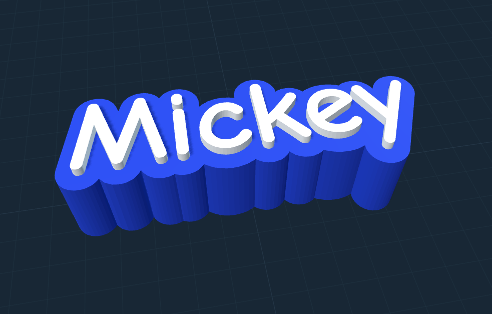
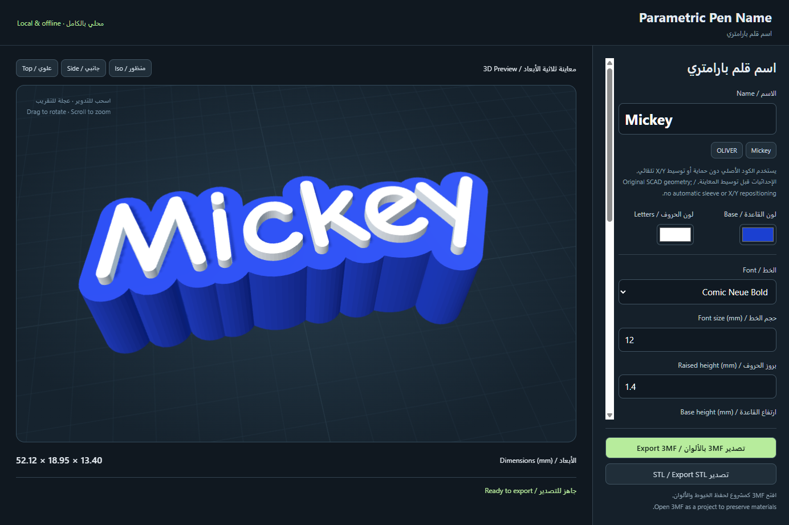

# Parametric Pen Name

اسم قلم بارامتري

[العربية](README.ar.md) · [Download Windows EXE](https://github.com/music-dj/parametric-pen-name/releases/latest)

Generate the original OpenSCAD pen-name model: text extruded 1.4 mm above a 12 mm outline base, with the original offset(delta = 2.3) contour. The original SCAD performs the actual rendering. Change font, size, outline margin, base height, relief, tunnel diameter/length/direction and coordinates, automatic Z centering, RTL alignment, and both colors. FRONTBACK means X axis; TOPBOTTOM means Y axis, matching the supplied script.





## Windows quick start

1. Download the Windows ZIP from [Releases](https://github.com/music-dj/parametric-pen-name/releases/latest).
2. Extract the complete ZIP into a normal folder.
3. Run `ParametricPenName.exe`; keep its other files beside it.
4. Enter your name, adjust settings, rotate the preview, then export STL or colored 3MF.

Runs locally without an account or internet connection. This portable release is unsigned. It has no installer.

## Export

All dimensions are millimeters. STL contains geometry only. 3MF contains separately colored volumes plus Bambu Studio/OrcaSlicer filament metadata. Open 3MF as a project and review material assignments. Printer profiles and filament calibration are not supplied; slicers can interpret color metadata differently. Example files are in [examples](examples).

## Settings

Name and both color pickers are always available.

| Setting | Label | Default |
| --- | --- | --- |
| `font` | الخط / Font | `comic` |
| `penLetterHeight` | حجم الخط / Font size (mm) | `12` |
| `letterThickness` | بروز الحروف / Raised height (mm) | `1.4` |
| `baseHeight` | ارتفاع القاعدة / Base height (mm) | `12` |
| `outlineMargin` | توسعة الإطار / Outline offset (mm) | `2.3` |
| `rtl` | محاذاة يمين / Right alignment | `false` |
| `holeOrientation` | محور النفق / Tunnel axis | `FRONTBACK` |
| `holeDiameter` | قطر النفق / Tunnel diameter (mm) | `7.8` |
| `holeLength` | طول النفق / Tunnel length (mm) | `150` |
| `holeX` | موضع X / X position (mm) | `21` |
| `holeY` | موضع Y / Y position (mm) | `4` |
| `autoHoleZ` | Z تلقائي / Automatic Z | `true` |
| `holeZ` | موضع Z / Z position (mm) | `6` |

## Limits

The original contour is preserved: changing text or enlarging the tunnel can expose it through narrow parts of the outline. Adjust margin, tunnel position, or diameter yourself; no hidden rectangular sleeve is added. Z is centered automatically by default, but X/Y remain explicit settings.

## Run from source

Requires Node.js 22+ and npm.

```powershell
npm ci
npm start
```

Install OpenSCAD 2021.01 and set `OPENSCAD_PATH` to its executable, or put its Windows installation in `runtime/openscad/`. The Windows release already bundles the engine.

## Test and package

```powershell
npm test
npm run test:ui
npm run build:windows
```
The build script creates a portable Windows folder in `dist/parametric-pen-name-windows`. Set `OPENSCAD_DIR` to the OpenSCAD installation directory before building. Set `ELECTRON_DIST` only when using an existing Electron runtime. Keep the complete output folder together.

Geometry checks cover 5 configurations, closed positive-volume meshes, invalid inputs, STL, and colored 3MF. UI checks cover initial load, fields, edits, reset, and both exports. The packaged Windows executable is also tested. Reports: [geometry](docs/geometry-test.json), [interface](docs/ui-test.json). Physical printing has not been tested.

## Source and attribution

The app is a standalone extraction of one generator from Keychain Studio. Only this generator is included; it has its own entry point and settings. Application code is covered by [LICENSE](LICENSE), subject to the exclusions and asset/model ownership in [ATTRIBUTION.md](ATTRIBUTION.md). Font licenses are included in `assets`. OpenSCAD remains a separate GPL program; see [OpenSCAD source](https://github.com/openscad/openscad/tree/openscad-2021.01).
